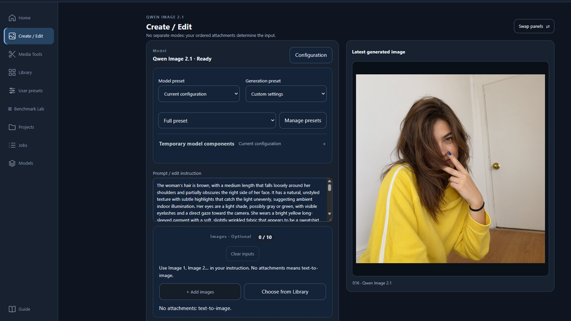
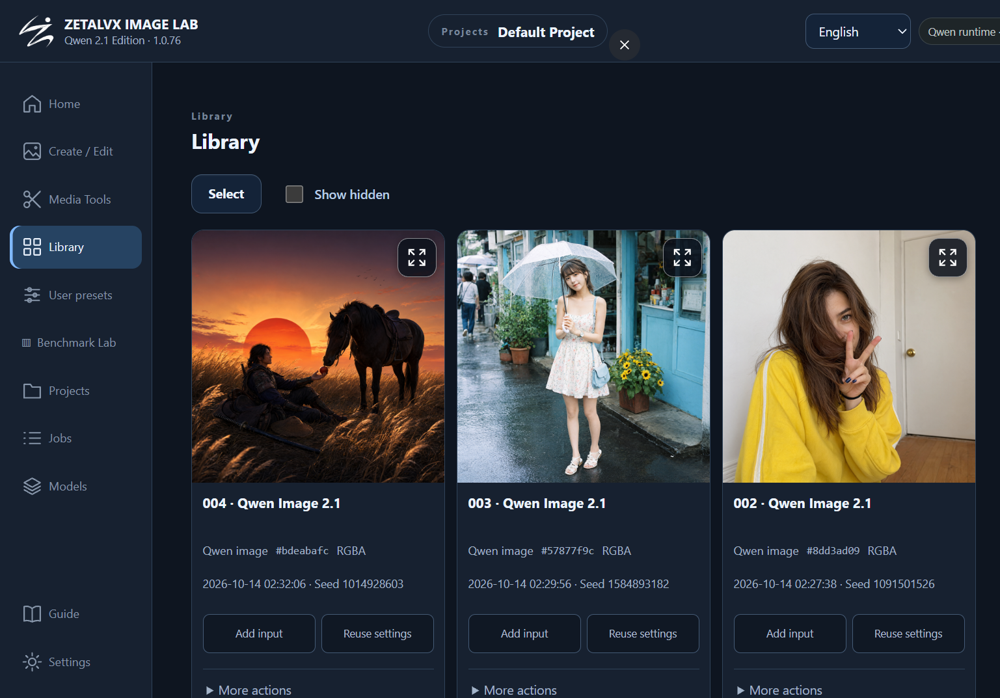
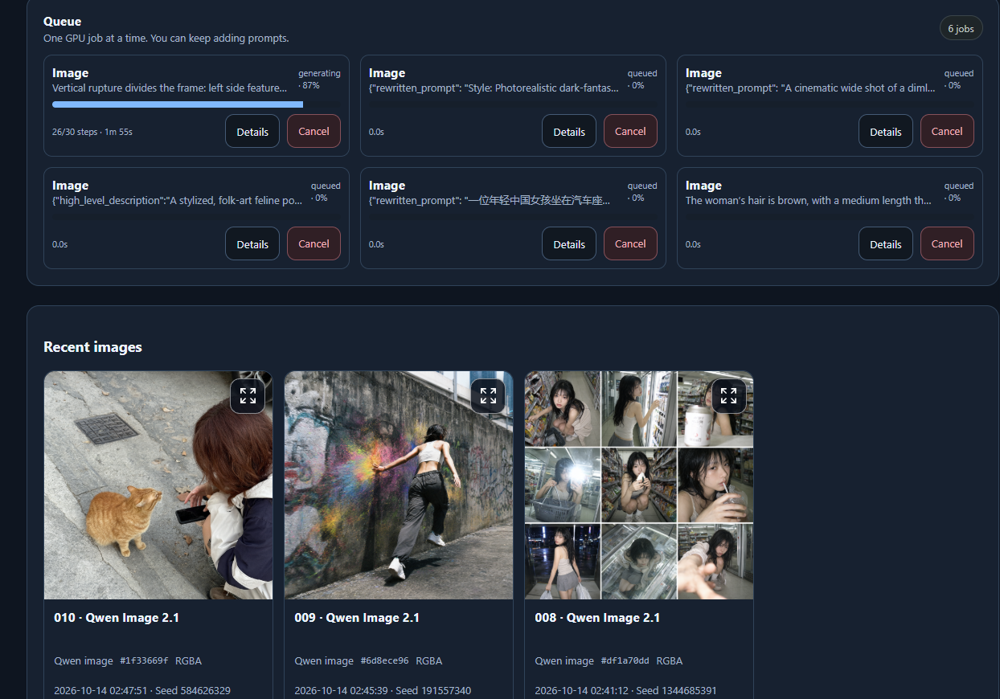
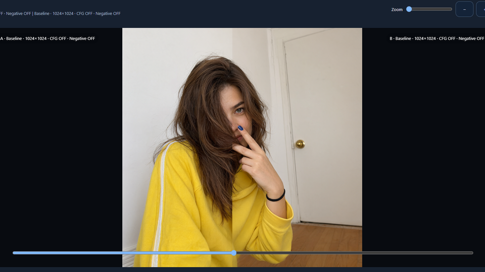

# Zetalvx Image Lab — Qwen Image 2.1 Edition

**Local Qwen Image 2.1 image generation, editing, model management and repeatable benchmarking.**  
Source code by **ZETALVX** · [Apache-2.0 for the application](LICENSE) · Unofficial, independent Qwen project.

> **This is the manual-source distribution, NOT the Patreon installer.** The GitHub repository contains the application code, assets, dependency lists and tests. It deliberately contains **no installer, automatic application updater, rollback system, uninstaller, bundled virtual environment or model weights**. Users set up Python, their venv, PyTorch/CUDA and optional tools themselves. Updating the source means reviewing and pulling the code manually, then updating dependencies in their own environment.
>
> Application source: Windows **1.0.76** / Linux **1.0.75**. These share the same generation interface and benchmark-scene features; the platform version difference comes from a Windows-only installer correction that is **not part of this repository**.

## Screenshots

## Screenshots

<p align="center">
  
  <br>
  <sub><b>Image Generation & Editing</b></sub>
</p>

<p align="center">
  
  <br>
  <sub><b>Image Library</b></sub>
</p>

<p align="center">
  
  <br>
  <sub><b>Generation Queue & History</b></sub>
</p>

<p align="center">
  
  <br>
  <sub><b>Image Comparison</b></sub>
</p>

## Features

- **Create / Edit:** text-to-image, single- and multi-image editing (up to ten reference images) and optional transparent-PNG output, subject to model/backend capability.
- **Persistent projects:** image history, stored generation parameters, selection and downloads.
- **Desktop preview:** latest result shown to the **right** of the settings by default; swap the panels if preferred. The history stays underneath. Image scaling preserves aspect ratio without cropping.
- **Models and components:** local repository paths, supported single-file Transformers, encoders, VAEs, compatible GGUF configurations and per-model options.
- **LoRA and presets:** compatible LoRA stacks and saved generation/model presets.
- **Benchmark Lab:** batch comparisons, configurable scenes (including personal scenes), selectable scene subsets, latency/VRAM/RAM measurements, CSV/JSON export and comparison gallery.
- **Decode Lab:** VAE/decode and latent round-trip comparisons.
- **Optional local ComfyUI bridge** for supported native paths and Prompt Enhancer; users provision ComfyUI separately.
- **Authenticated HTTPS** web interface, local-only by default; LAN access is optional and should be limited to trusted networks.

Feature compatibility varies by checkpoint, quantization and auxiliary component. A model passing a file check is **not** proof that it can perform CUDA inference.

## Repository layout

```text
.
├── linux/                     # Linux application source
│   ├── source_run.py          # Manual web / GPU worker launch
│   ├── app.py                 # Web API and project logic
│   ├── core/                  # Qwen runtime configuration, security, jobs, benchmarks
│   ├── services/              # Qwen image worker, loaders, decode and measurement
│   ├── static/                # Web UI
│   ├── templates/             # Web pages
│   ├── config/                # Model defaults (no weights)
│   ├── requirements-*.txt
│   └── tests/
├── windows/                   # Windows-specific source; same application features
├── docs/
│   ├── MANUAL_SETUP.md        # Manual environment setup and operation
│   └── SOURCE_DISTRIBUTION.md # Source-vs-installer and update policy
├── LICENSE
├── NOTICE
└── THIRD_PARTY_NOTICES.md
```

Only work in **one** platform directory. Do not merge `linux/` and `windows/` or run them simultaneously against the same data directory.

## Requirements

- Windows 10/11 x64 or Linux x86_64.
- **CPython 3.11** recommended, `venv`, pip, Internet access for dependencies and downloads.
- Compatible NVIDIA GPU and working CUDA driver for local image inference. VRAM demand depends on checkpoint/precision/offload/resolution; large Qwen weights can exceed consumer-GPU limits.
- Sufficient RAM and free storage for model weights and caches.
- Optional: FFmpeg for video-frame tools, a separately configured ComfyUI environment for supported external operations.

The original binary installer used a reviewed **PyTorch 2.14.0 / torchvision 0.29.0** runtime on a **cu126** NVIDIA wheel index and a specific Diffusers source revision. Manual users should use a compatible backend/wheel for their system and validate CUDA before use. This source retains a fail-closed minimum reviewed PyTorch version check. See [manual setup](docs/MANUAL_SETUP.md).

### Quick start — Linux

```bash
cd linux
python3.11 -m venv .venv
source .venv/bin/activate
python -m pip install --upgrade pip setuptools wheel
python -m pip install --index-url https://download.pytorch.org/whl/cu126 torch==2.14.0 torchvision==0.29.0
python -m pip install -r requirements-app.txt -r requirements-qwen21.txt
python -m pip install --no-deps --no-build-isolation https://github.com/huggingface/diffusers/archive/80c7ed262aeffbeb43ef13ae04baeb9b84515a69.tar.gz
python -m pip check
python -c "import torch; print(torch.__version__, torch.cuda.is_available())"
```

Then, with the same venv activated, start **two foreground terminals** from the `linux` directory:

```bash
python source_run.py image   # terminal 1: GPU worker, loopback port 8299
python source_run.py web     # terminal 2: HTTPS web server, loopback port 8298
```

Open **https://127.0.0.1:8298** on the host and complete account setup using the first-run code displayed by the web process. You may need to acknowledge the self-signed local certificate warning.

### Quick start — Windows (PowerShell)

```powershell
cd windows
py -3.11 -m venv .venv
.\.venv\Scripts\Activate.ps1
python -m pip install --upgrade pip setuptools wheel
python -m pip install --index-url https://download.pytorch.org/whl/cu126 torch==2.14.0 torchvision==0.29.0
python -m pip install -r requirements-app.txt -r requirements-qwen21.txt
python -m pip install --no-deps --no-build-isolation https://github.com/huggingface/diffusers/archive/80c7ed262aeffbeb43ef13ae04baeb9b84515a69.tar.gz
python -m pip check
python -c "import torch; print(torch.__version__, torch.cuda.is_available())"
```

Open a **second** PowerShell window in `windows/`, activate the same venv and start the other component:

```powershell
python source_run.py image   # one terminal
python source_run.py web     # the other terminal
```

To stop them, press `Ctrl+C` in their respective terminals. If PowerShell blocks venv activation, run `.\.venv\Scripts\python.exe` directly instead. **No one-click scripts or services are registered** by this source tree.

**The commands above are manual setup examples, not an installer.** We cannot guarantee third-party wheels remain available on every platform; check versions and compatibility before installing. Detailed steps, troubleshooting and account recovery: **[docs/MANUAL_SETUP.md](docs/MANUAL_SETUP.md)**.

## Models and personal data

No weights, model datasets, prompts, saved images, credentials, certificates or user settings are included. After starting the app, link your already downloaded **Qwen Image 2.1** repository in **Models** (or use its model/component download features where licensing permits). Downloads are model-related and **not an app updater**.

Source checkouts keep data separate from the Patreon installation by default:

| Platform | Default manual-source data directory |
|---|---|
| Linux | `~/.local/share/ImageLabQwen21Source` |
| Windows | `%LOCALAPPDATA%\ImageLabQwen21Source` |

Set `QWEN_SOURCE_HOME` to another absolute directory if desired. The application stores its projects, model links, secrets and generated HTTPS certificate under this user-selected data directory, **outside the Git repository**. Do not point it to an existing installed-edition data folder unless you understand the risks and have a backup.

## Updates and maintenance

There is **no in-app application updater, uninstall button, rollback, automatic dependency upgrade or background release installer**. To update: stop both terminals, back up your data, `git pull` after reviewing changes, inspect updated `requirements-*.txt`, then manage your own virtual environment. For removal: stop both processes and manually delete the checkout, its locally created venv and (only if you deliberately choose) the separate personal data directory.

The **Patreon builds** are separate install/update distributions: Windows 1.0.76 and Linux 1.0.75. They are not required to use this source repository. See [source distribution policy](docs/SOURCE_DISTRIBUTION.md).

## Security

- Default web bind: `127.0.0.1:8298` over self-signed HTTPS; GPU worker: `127.0.0.1:8299` with an internal authentication key.
- Keep the worker loopback-only. Do not port-forward or expose this application directly to the public Internet.
- LAN access requires an explicit configuration change and manual review of your host firewall/VPN settings.
- Account/password and first-run code are host-local controls. Never commit your data directory, `*.pem`, tokens or model credentials.
- Treat external model weights and runtime components as untrusted inputs until reviewed; compatibility and licensing belong to their publishers.

See [SECURITY.md](SECURITY.md) for reporting and deployment caveats.

## Testing

With the relevant source folder selected, run:

```bash
python -m unittest discover -s tests -v
```

These tests cover selected benchmark/scene/LoRA logic. They do **not** constitute an end-to-end GPU, Windows system, dependency-resolution or security audit.

## Licensing

The **application's own source** is distributed under [Apache License 2.0](LICENSE), with [NOTICE](NOTICE) and [third-party notices](THIRD_PARTY_NOTICES.md). Model weights, checkpoints, datasets and external runtimes have their **own separate terms**. In particular, do **not** assume Qwen Image 2.1 weights inherit Apache-2.0 from this application; read the model's current license and obtain the relevant commercial permission where required. No model weights are distributed here.

Developed by **[ZETALVX](https://github.com/ZETALVX)** · [YouTube](https://www.youtube.com/@zetalvx) · [Website](https://zetalvx.com/)
